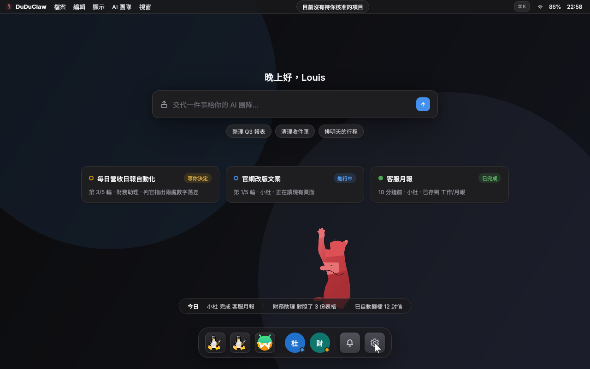

# DuDuClaw OS

<div align="center">

[繁體中文](README.zh-TW.md) · **English**

</div>

DuDuClaw OS is a Yocto-built Linux operating system in which the AI agent is a native resident: it turns an x86-64 box into a machine for [DuDuClaw](https://github.com/zhixuli0406/DuDuClaw) AI employees. It has a desktop of its own (an in-house Wayland compositor and shell, a lock screen, a first-run wizard, Cmd+K to hand work to the agent from anywhere), so a person and the AI share one machine without getting in each other's way: the agent's GUI work runs in a shadow workspace by default, and the moment you touch the keyboard or mouse, whatever it was driving on your desktop yields. The dashboard is served by the gateway, so the box is operable from a browser on the LAN with or without a screen.



<sub>Desktop edition home screen (captured on v0.2.0; not yet re-shot for v0.3.0 or v0.4.0).</sub>

This repo is the **base-OS line**: the `meta-duduclaw/` Yocto layer (distro policy, machine configs, recipes for the `duduclaw-*` binaries) plus the `scripts/release-os.sh` build / sign / publish pipeline. The DuDuClaw platform's Rust workspace lives in its own repo and is vendored here as a trimmed snapshot.

[](https://github.com/zhixuli0406/DuDuClaw-OS/releases)
[](LICENSE)

> **Status: bring-up (0.4.0, pre-GA, embedding platform v1.73.4).** The image boots and updates A/B with rollback; the trust chain is wired in the layer but, as of v0.4.0, published images still do not enable signing / verity / TPM (see Trust chain). This is not a general-availability release: the `0.x` line tracks bring-up, `1.0.0` will mark the first GA. All verification so far is under QEMU; **the image has not yet been booted on real x86-64 hardware**.

**New in v0.4.0** (2026-10-16): the gateway no longer runs as root. It runs as the `duduclaw` account (uid 1000), and the desktop edition's containers (task sandbox, script sandbox, computer use, discovery) run on rootless Podman instead of root Docker; if the engine does not enforce resource limits, those features turn themselves off. `duduclaw-sysd`, the only root helper, accepts requests only from the gateway's main process and verifies OS updates itself before installing them. SSH is off by default and opens only through the dashboard's maintenance mode, and the base edition now has the same default-deny firewall as the desktop edition. Factory reset wipes data at the next boot, before any service starts. **The upgrade is one-way:** once a v0.4.0 image has booted successfully, the device cannot go back to v0.3.0 or earlier. The published v0.4.0 images have no SSH login account, so their maintenance switch only controls the port. Full list: [CHANGELOG](CHANGELOG.md), section 0.4.0.

**Unreleased source:** the layer now vendors platform v1.74.0 at commit
`a1f5fd6a964a17c2d3ad9e1165f6df3a8586c213`, including the keyed SSH gateway,
privileged helper and dashboard. The CLI recipe also builds the restricted
`maint-shell` and root `maint-helper`; the account package installs the SSH
readiness marker. Image checks require those binaries, the account, hardened
services and firewall, and refuse any baked-in `authorized_keys`. An Admin
must supply one technician public key for a window of at most 24 hours;
there is no password login or general shell. **This source candidate has not
yet passed a Yocto image build or QEMU verification.** Published downloads
remain v0.4.0 with platform v1.73.4. See [Security](SECURITY.md) for limits.
The maintenance shell now treats Dropbear’s empty original-command value as
a request for the fixed interactive menu; nonempty commands retain the
existing allowlist. Fresh image and real SSH verification are pending.
The security snapshot upgrades ZIP handling to zip 9.0.4 and rust_xlsxwriter
0.100.0 and carries the platform's checksum-pinned calamine compatibility
patch. The CLI crate-fetch include still requires BitBake `update_crates`;
this intermediate source must not be baked or accepted until it is regenerated.

## Contents

- [Why DuDuClaw OS?](#why)
- [What's in the image](#whats-inside)
- [Desktop environment](#desktop)
- [Trust chain](#trust)
- [Quick start: download, verify, flash](#quickstart)
- [Build from source](#build)
- [Repo layout](#layout)
- [Documentation](#docs)
- [License](#license)

<a id="why"></a>

## Why DuDuClaw OS?

Installing Linux yourself and then `duduclaw` on top works fine. Putting that box behind a counter, or handing it to a customer with no engineer, means you also own updates, rollback, tamper resistance, and first-time setup. DuDuClaw OS builds those into the image:

| Need | Your own Linux + duduclaw | DuDuClaw OS |
|---|---|---|
| First-time setup | SSH in and edit config | Auto-provisioned on first boot; the dashboard appears on the LAN |
| System updates | Package manager; you fix failures | A/B dual-slot atomic update, automatic rollback on boot failure |
| Tamper resistance | Roll your own | Read-only root (desktop edition default); dm-verity block verification wired, enabled by a build overlay (still not enabled as of v0.4.0) |
| Boot trust | Secure Boot usually turned off | Self-signed Secure Boot, a dual-signed UKI per slot, first-boot key enrollment — wired, enabled by a build overlay (images remain unsigned through v0.4.0; boot with Secure Boot off) |
| Disk keys | Manual LUKS | TPM2 PCR 7+11 sealing (build overlay option, partial, still not enabled as of v0.4.0) |
| Desktop and apps | Install one by one | Own compositor/shell, Flatpak offline repo (Chromium and LibreOffice install from the Launcher with no network), Chinese IME |
| One machine shared by a person and the AI | Separate windows, unaware of each other | Built-in delegation bar (Cmd+K); the agent's GUI work runs in a shadow workspace by default and never touches your windows or cursor; any input from you freezes an agent driving on your desktop |
| AI toolchain | `npm install -g` one vendor at a time, redone on every machine | Ten vendor CLIs in the image: `claude`, `codex`, `gemini`, `qwen`, `kimi`, `copilot`, `grok`, `agent` (Cursor), `opencode`, `vibe` — working at first boot, credentials on `/data` so an update never wipes them |
| Offline inference | Build llama.cpp yourself, write your own unit | llama.cpp `llama-server` in the image; weights downloaded from the dashboard into `/data/duduclaw/models`, so delegation keeps working with no network |

<a id="whats-inside"></a>

## What's in the image

- **Yocto Project 6.0 "wrynose"** (LTS), default kernel Linux 6.18.
- Two machines: `duduclaw-qemux86-64` (the QEMU-bootable bring-up target) and `duduclaw-genericx86-64` (real x86-64 hardware, x86-64-v3 tune).
- Each release publishes three artifacts per machine, each with a `.sha256` and a minisign `.minisig`:

| Artifact | Contents | Use |
|---|---|---|
| `duduclaw-os-<machine>-v<ver>.wic.zst` | **Desktop edition** `duduclaw-image-appliance`: A/B update chain + desktop shell + offline Flatpak repo (Chromium / LibreOffice) + IME + app compatibility layer + read-only root + firewall + login hardening | Whole-disk flash; the daily driver |
| `duduclaw-os-installer-<machine>-v<ver>.iso` | `duduclaw-image-live`: squashfs live environment + graphical installer. It writes the **base image** `duduclaw-image-ab`: the same A/B layout, desktop shell and gateway, without the app layer, compatibility layer or read-only root (since v0.4.0 it has the same firewall as the desktop edition) — a bring-up artifact | Flash to USB, boot, install |
| `duduclaw-os-installer-desktop-<machine>-v<ver>.iso` | `duduclaw-image-live-desktop`: the same installer, writing the desktop edition `duduclaw-image-appliance` (added on 2026-09-04, alongside v0.1.0, and shipped with every release since) | Flash to USB, boot, install; yields the same desktop edition as the whole-disk image |

<a id="desktop"></a>

## Desktop environment

Every DuDuClaw OS image boots straight into its own desktop, fully operable from the keyboard (the desktop edition adds the app layer and shipping hardening, see the table above):

- **In-house compositor and shell** — `duduclaw-comp` (Wayland compositor) + `duduclaw-shell` (the desktop shell): home screen, window switcher, lock screen, control center; Cmd+K summons the delegation bar over any app to hand work to an AI employee. The full shortcut list is on the docs site: [OS keyboard shortcuts](https://os.duduclaw.dudustudio.monster/docs/en/features/51-os-keyboard-shortcuts/).
- **First-run wizard** — language, account, theme and Wi-Fi are set in a graphical wizard on first boot; the installer ISO is a graphical wizard too (pick disk, confirm, write progress, reboot).
- **Input and audio** — fcitx5 Chinese IME, PipeWire / WirePlumber audio, XWayland for X11 apps.
- **Shared without getting in your way** — the agent has its own input seat; GUI tasks run on a headless shadow output by default (with an optional picture-in-picture preview) and never touch your windows, focus or cursor; human input always wins, with the compositor freezing an agent driving on your desktop (3–4 ms measured under QEMU); Super+Enter hands back, Super+Esc is the emergency stop; co-driving is off by default, consequential actions are approved first, and logins / payments are always handed to you. Full write-up on the docs site: [Desktop edition](https://os.duduclaw.dudustudio.monster/docs/en/features/52-desktop-edition/).
- **AI toolchain in the image** (desktop edition) — ten vendor coding CLIs bundled under `/opt/duduclaw/runtimes`, with `claude`, `codex`, `gemini`, `qwen`, `kimi`, `copilot`, `grok`, `agent`, `opencode` and `vibe` on `PATH` at first boot. Credentials all land in `/data/duduclaw` (mode 0700), so a system update never wipes them. The platform deprecated its Gemini CLI runtime in v1.67.0; platform 1.73.4, which v0.4.0 embeds, still carries it; the platform has since postponed the removal to v1.75.0, and `gemini` leaves this list once the OS syncs to a platform release without it. Platform 1.73.4 also lists Google Antigravity (`agy`), which the image does not bundle; the dashboard shows the vendor install command. Local inference runs on llama.cpp's `llama-server`; no model weights ship in the image — the dashboard downloads one into `/data/duduclaw/models`. What is deliberately *not* bundled, and how to regenerate the payload: [AI runtimes guide](docs/guides/ai-runtimes.md).
- **Apps** (desktop edition) — the image carries an offline Flatpak repo: Chromium and LibreOffice install from the Launcher with no network; other apps, Steam included, come from Flathub. The app compatibility layer is declared through `compat.d`: Bottles for Windows desktop apps, a KVM virtual machine + RDP for full Windows, Waydroid for Android (no GApps, self-setup); macOS apps are not run locally. Scope and the explicit non-promises are in the [app compatibility guide](docs/guides/app-compat.md) (on the docs site: <https://os.duduclaw.dudustudio.monster/docs/en/os/guides/app-compat/>).

The base image the installer ISO writes (`duduclaw-image-ab`) has the same desktop shell and gateway, just without the app layer; the dashboard is served by the gateway, so the box is operable from a browser on the LAN with or without a screen. What the desktop itself does with no monitor attached (whether it falls back to a purely headless box) has not been defined on real hardware yet; it is a bring-up open item.

<a id="trust"></a>

## Trust chain

The layer wires the whole chain, but as of v0.4.0 the published images enable only part of it. Shipped: **A/B atomic update with rollback** and a **read-only root** (desktop edition). The three items below are build-time overlay options that **no artifact through v0.4.0 enables**; the v0.4.0 release notes say so, and its test build on the GCP builder used `kas/release-linux-builder.yml` like v0.3.0. v0.3.0 was built with `kas/release-linux-builder.yml` and without `sb-signing.yml` / `tpm-luks.yml`; opening both published wic images (2026-10-14) confirms it: the slot UKI, the rescue UKI and systemd-boot all have an empty PE certificate table, the ESP carries no enrollment keys, the GPT holds only the ESP, two root slots and data (no verity partition), and the UKI initrd contains no tpm2 or cryptsetup tooling. The same check on v0.2.0 at its release found the same (no signatures, no verity partition, no TPM packages):

- **Secure Boot + dm-verity** (`kas/sb-signing.yml`) — self-signed PK/KEK/db, a dual-signed UKI per slot, first-boot key enrollment; the rootfs verified block by block, so tampering fails the read.
- **TPM2 + LUKS** (`kas/tpm-luks.yml`, partial) — PCR 7+11 measured-boot key sealing with a fail-open recovery path is wired; automatic enrollment is an open defect pending a real-hardware TPM (QEMU/swtpm cannot complete it).
- **Signed release artifacts** (enabled) — every file ships with a `.sha256` and a minisign `.minisig`; the public key is pinned in `scripts/release-os.sh` and re-verified fail-closed before upload. Vulnerability reporting: [SECURITY.md](SECURITY.md).

`scripts/release-os.sh build` currently chains only `kas/serial1.yml` by default (the release overlay: serial `-j1` build + SPDX off; large Linux builders use `kas/release-linux-builder.yml` instead), not `sb-signing.yml` / `tpm-luks.yml`; producing signed images means building with those two overlays by hand, which is on the list for the next release.

<a id="quickstart"></a>

## Quick start: download, verify, flash

Download the artifact plus its `.sha256` and `.minisig` from [GitHub Releases](https://github.com/zhixuli0406/DuDuClaw-OS/releases), and verify before flashing:

```bash
minisign -V -P RWQyI00ugZ/+WVisQ2ZnKeTqFs8Ze8h2X11FO9Z8le0YubFMXYTwQD7n -m <file>
shasum -a 256 -c <file>.sha256
```

**Installer ISO: `installer-desktop` = desktop edition; `installer` = base image (desktop shell + gateway, no app layer)**

```bash
dd if=<iso> of=/dev/<usb> bs=4M conv=fsync    # or balenaEtcher
```

Boot the target in UEFI mode with **Secure Boot off** (published images remain unsigned through v0.4.0; only signed builds enroll the DuDuClaw keys on first boot). Boot from the USB stick, pick the target SSD in the graphical installer, and reboot: the installed system is the A/B UKI + systemd-boot layout, and the dashboard is reachable from a browser on the same LAN.

**Unreleased installer fix:** development source now stops on decoder, progress-pipe or disk-write failure and reserves 100% for a successfully flushed image stream. It can leave a partially written disk on failure; retry the installation before booting that disk. Host regression tests pass; rebuilding and real blank-disk installation of both ISOs are still required. See [installer tests](appliance/tests/installer/README.md).

**Whole-disk image (desktop edition: desktop + apps + shipping hardening)**

```bash
zstd -d --long=27 <wic.zst>
dd if=<wic> of=/dev/<target-disk> bs=4M conv=fsync    # or bmaptool copy
```

> Before v0.4.0 was published, the `duduclaw-qemux86-64` whole-disk image was booted on the GCP builder under headless QEMU (software emulation, no KVM) to the login prompt (about 65 s), and both installer ISOs for that machine booted to the live environment's automatic root login (about 125 s each). The installer wizard was **not run** this release; the last full QEMU installs on record are still v0.1.0 and a 2026-09-06 development build. Separately, the qemux86-64 test variant of the desktop image went through two rounds of rootless-gateway checks; the second round passed 35 of 36 (the remaining one is a doctor headline wording issue, fixed in platform main). Not verified yet: upgrading a v0.3.0 device through the A/B update path, the full LLM-backed task sandbox / computer use / discovery flows, the Windows VM (needs KVM), real-hardware Wi-Fi and audio. `duduclaw-genericx86-64` is the real-hardware target and cannot be booted under QEMU; in v0.4.0 it was built but not booted (neither the whole-disk image nor its two ISOs), and a real-hardware boot is the most important open validation item.
>
> **One-way upgrade.** Once a v0.4.0 image has booted successfully, the device can no longer go back to v0.3.0 or earlier (those run the gateway as root). Recovering from a bad later release means installing a fixed newer image or using the rescue entry.

<a id="build"></a>

## Build from source

Prerequisites:

- Docker. The Yocto build runs inside a `duduclaw-yocto-builder` container (macOS has no native bitbake).
- A sibling checkout of the platform repo, needed only to refresh the vendored snapshots (`scripts/sync-platform.sh <platform-version>` does all four plus the version bump, see `docs/guides/platform-sync.md`; per recipe: `meta-duduclaw/recipes-duduclaw/duduclaw-cli/refresh-src.sh`; override the path with `DUDUCLAW_CLI_SRC_ROOT`).
- `minisign` and `gh` for signing and publishing.

```bash
./scripts/release-os.sh audit      # show OS + embedded-platform versions
./scripts/release-os.sh build      # kas build inside the running builder
./scripts/release-os.sh smoke      # headless QEMU boot to a login prompt
./scripts/release-os.sh package    # smoke gate + compress + sha256 + minisign
./scripts/release-os.sh sign       # sign a set made by package --no-sign on a builder
./scripts/release-os.sh publish    # upload to a GitHub Release
```

The generic image requests built-in KVM guest support. Its kernel build refuses an effective `.config` missing the guest/clock dependencies or required VirtIO and PCI MSI options; host KVM modules keep their existing settings. This build check does not replace native GCE boot and installer validation. See the [layer build reference](meta-duduclaw/README.md#build).

The installed initramfs requests `/run` mode 0755 for strict SSH key-path checks; runtime permissions and normal maintenance login still need guest verification.

A remote builder (GCP, for example) never holds the signing key: run `package --no-sign` there, copy `artifacts/os/v<version>/<machine>/` back to the machine that has the key, then run `sign` and `publish`. A Linux builder with plenty of memory can set `DUDUCLAW_OS_KAS_OVERLAY=meta-duduclaw/kas/release-linux-builder.yml` instead of the default `serial1.yml` (SPDX still off, no `-j1`); pass the same value to `build`, `smoke` and `package`.

The log patterns `smoke` uses to decide "reached a login prompt" and "QEMU / kas gave up" have their own test: `scripts/tests/smoke-patterns.sh` (no Docker or QEMU needed; it checks each line of the samples in `scripts/tests/fixtures/smoke/`).

Every subcommand's `v<version>` is optional and defaults to the `VERSION` file, the OS's own release line, independent of the embedded platform version. Run `release-os.sh` with no argument for the full usage text. Builder container setup, cache and disk layout, and the role of each image recipe are in [`meta-duduclaw/README.md`](meta-duduclaw/README.md).

<a id="layout"></a>

## Repo layout

| Path | What |
|---|---|
| `meta-duduclaw/` | the Yocto layer (distro, machines, images, `duduclaw-*` recipes, kas configs) |
| `scripts/release-os.sh` | the `build → smoke → package → publish` pipeline |
| `VERSION` | the OS's independent release version |
| `docs/` | public docs, one subdir per type, indexed in `docs/README.md` |
| `wiki/` | internal bring-up notes, acceptance checklists, evidence logs |
| `appliance/` | the earlier Debian/mkosi appliance line, **frozen**, kept as a reference/transition artifact; the product is not built from here |

<a id="docs"></a>

## Documentation

- Website and docs site: <https://os.duduclaw.dudustudio.monster> (home and download pages; the docs site lives at `/docs/` on the same domain, combining this repo's and the platform repo's public docs in zh-TW / en / ja, and never links to GitHub). GitHub itself is kept to the repo, Releases, Issues, and LICENSE.
- [`docs/README.md`](docs/README.md) — the documentation index for this repo (public docs, component references, internal notes, the placement rule).
- [`meta-duduclaw/README.md`](meta-duduclaw/README.md) — layer reference: layout, image roles, builder container, `kas build`.
- [`CHANGELOG.md`](CHANGELOG.md) — release history, Keep a Changelog format.
- [`CONTRIBUTING.md`](CONTRIBUTING.md) / [`SECURITY.md`](SECURITY.md) — how to contribute, how to report vulnerabilities.
- User-facing feature docs (authored in the platform repo, published on the docs site): [DuDuClaw OS appliance](https://os.duduclaw.dudustudio.monster/docs/en/features/50-duduclaw-os-appliance/), [hardware requirements](https://os.duduclaw.dudustudio.monster/docs/en/guides/hardware-requirements/). The [app compatibility layer](docs/guides/app-compat.md) guide lives in this repo.

<a id="license"></a>

## License

Apache License 2.0, the same license as the [DuDuClaw](https://github.com/zhixuli0406/DuDuClaw) platform. See [LICENSE](LICENSE).
